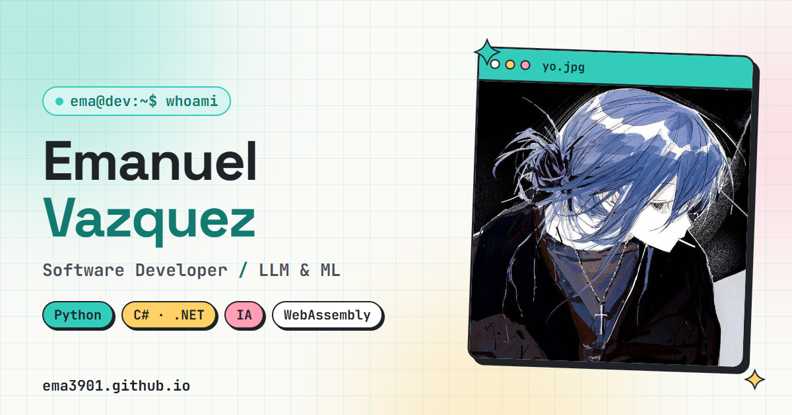

# ema3901.github.io

Portafolio personal de **Emanuel Vazquez**: desarrollador de software autodidacta en camino a la ingeniería de IA (LLMs y Machine Learning), con bases en Python, C#, .NET y WebAssembly.

**Sitio:** https://ema3901.github.io



## Qué hay aquí

- **Inicio**: presentación, `whoami`, experiencia, proyectos y stack.
- **Proyectos**: páginas de detalle de cada proyecto (`proyecto1.html`, `proyecto2.html`, `proyecto3.html`).
- **Contacto**: modal con email, CV en español e inglés y redes.
- **404**: página de error con un letrero 3D low-poly.

## Tecnologías

- HTML, CSS y JavaScript sin frameworks ni paso de build.
- [Three.js](https://threejs.org/) (vía CDN) solo en la página 404, para el letrero 3D low-poly.
- Google Fonts (Space Grotesk, Inter, JetBrains Mono) y Font Awesome.
- Alojado en GitHub Pages.

## Estructura

```
├── index.html            # Página principal
├── proyecto1-3.html      # Detalle de proyectos
├── template.html         # Plantilla para nuevos proyectos
├── 404.html              # Página de error
├── css/
│   ├── index.css         # Estilos base, tema claro/oscuro
│   └── proyecto.css      # Estilos de las páginas de proyecto
├── js/
│   ├── index.js          # Tema, scroll, carrusel, modal
│   └── proyecto.js       # Tema y animaciones en proyectos
├── cv/                   # CV en PDF (ES / EN)
└── img/                  # Imágenes, favicon y tarjeta Open Graph
```

## Correr localmente

Se puede abrir `index.html` directamente, o servir la carpeta para probar rutas como la 404:

```bash
python -m http.server 8000
# abre http://localhost:8000
```

## Agregar un proyecto

1. Copia `template.html` como `proyectoN.html` y reemplaza los `[MARCADORES]`.
2. Pon las imágenes en `img/proyectoN/` (GitHub Pages distingue mayúsculas y minúsculas).
3. Agrega la tarjeta en la sección `#proyectos` de `index.html`.

## Contacto

emanuel.dev39@gmail.com · [LinkedIn](https://www.linkedin.com/in/ema-vazquez/) · [GitHub](https://github.com/Ema3901)
